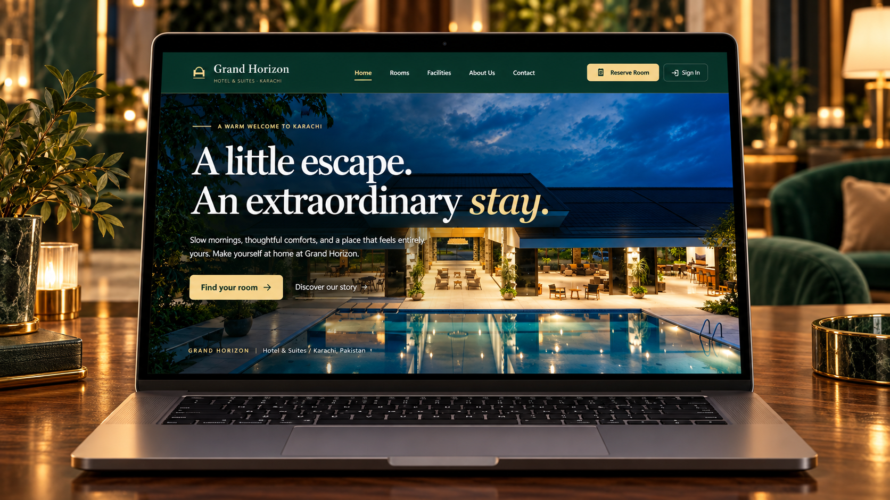
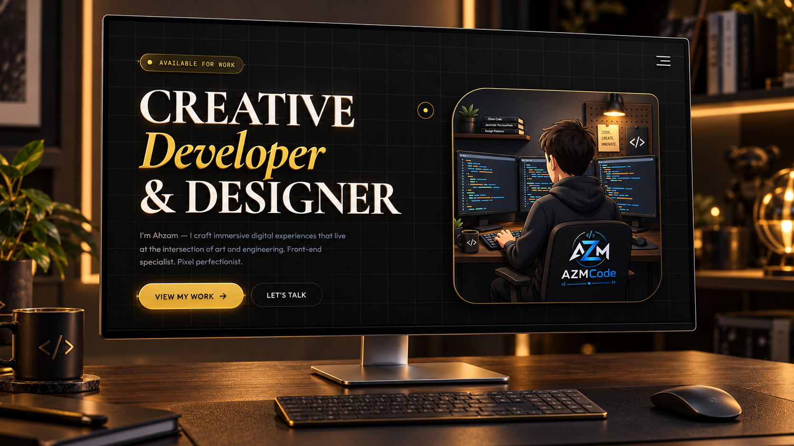
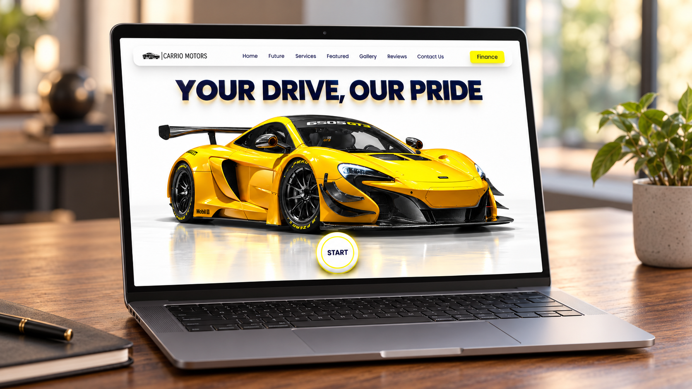
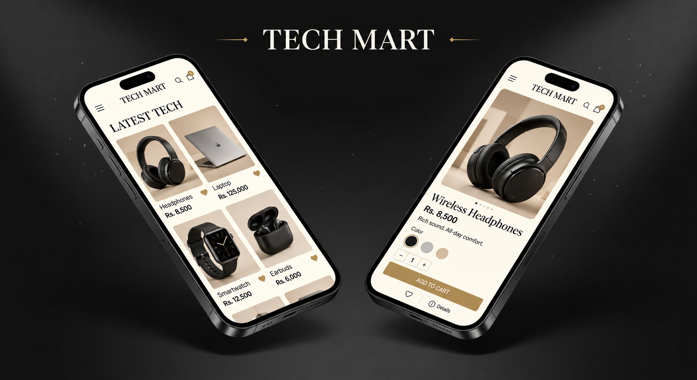
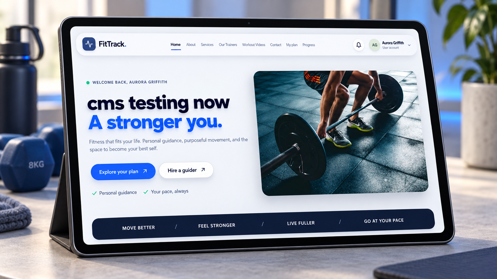

<div align="center">

<!-- ═══════════════════════════════════════════════════════════ -->
<!--                    CINEMATIC HEADER                        -->
<!-- ═══════════════════════════════════════════════════════════ -->


<br/>

<!-- BADGE ROW — PROFILE VIEWS + STATUS -->

&nbsp;

&nbsp;


<br/><br/>

<!-- MASTER TYPING ANIMATION -->


<br/>

---

</div>

<!-- ═══════════════════════════════════════════════════════════ -->
<!--                      ABOUT ME                             -->
<!-- ═══════════════════════════════════════════════════════════ -->

### 🧑‍💻 &nbsp; The Mind Behind the Code


```typescript
const Ahzam: Developer = {
  name        : "Ahzam Azeem",
  title       : "MERN Stack Developer",
  location    : "🌍 Pakistan — building for the world",
  stack       : {
    frontend  : ["React", "React Native", "Three.js", "Tailwind"],
    backend   : ["Node.js", "Express.js", "REST APIs"],
    database  : ["MySQL"],
    tools     : ["Git", "GitHub", "VSCode", "Postman", "npm"],
  },
  currentFocus: "Scalable architecture + stunning UX",
  openTo      : ["Freelance", "Full-time", "Collaboration"],
  philosophy  : "Ship. Iterate. Grow. Repeat.",
  funFact     : "I debug in my dreams 🛠️",
};
```

<br clear="right"/>

---

<!-- ═══════════════════════════════════════════════════════════ -->
<!--                    FEATURED GALLERY                       -->
<!-- ═══════════════════════════════════════════════════════════ -->

<div align="center">

### 🎬 &nbsp; Featured Gallery — The Best of Ahzam Azeem
<br/>

<table border="0">
  <tr>
    <td align="center" width="50%">
      <a href="https://github.com/ahzamazeem/Hotel_Management_System" target="_blank">
        
      </a>
      <br/>
      <b>Hotel Management System</b><br/>
    </td>
    <td align="center" width="50%">
      <a href="https://ahzamazeem.github.io/Gsap_Portfolio/" target="_blank">
        
      </a>
      <br/>
      <b>GSAP Portfolio</b><br/>
    </td>
  </tr>
  <tr>
    <td align="center" width="50%">
      <a href="https://ahzamazeem.github.io/carrio-motors/" target="_blank">
        
      </a>
      <br/>
      <b>Carrio Motors</b><br/>
    </td>
    <td align="center" width="50%">
      <a href="https://github.com/ahzamazeem/Tech_Mart" target="_blank">
        
      </a>
      <br/>
      <b>Tech Mart</b><br/>
    </td>
  </tr>
  <tr>
    <td align="center" width="50%">
      <a href="https://github.com/ahzamazeem/Covid-Awareness" target="_blank">
        
      </a>
      <br/>
      <b>Covid Awareness</b><br/>
    </td>
    <td align="center" width="50%">
      <a href="https://github.com/ahzamazeem/Fit-Track" target="_blank">
        
      </a>
      <br/>
      <b>Fit Track</b><br/>
    </td>
  </tr>
</table>

</div>

---

<!-- ═══════════════════════════════════════════════════════════ -->
<!--                    TECH ARSENAL                           -->
<!-- ═══════════════════════════════════════════════════════════ -->

<div align="center">

### 🛠️ &nbsp; Tech Arsenal
<br/>

<table>
<tr>
<td align="center" width="50%">

**⚡ Frontend & 3D**


</td>
<td align="center" width="50%">

**🔧 Backend & Data**


</td>
</tr>
<tr>
<td align="center">

**📱 Mobile**


<br/><sub><sup>React Native</sup></sub>

</td>
<td align="center">

**🧰 Tools & DevOps**


</td>
</tr>
</table>

</div>

---

<!-- ═══════════════════════════════════════════════════════════ -->
<!--               CURRENTLY BUILDING                          -->
<!-- ═══════════════════════════════════════════════════════════ -->

### 🚀 &nbsp; What I'm Up To
<table>
<tr>
<td>🔭 <b>Currently Building</b></td>
<td>Full-stack production apps with React + Node.js</td>
</tr>
<tr>
<td>🌱 <b>Currently Learning</b></td>
<td>Advanced Three.js, WebGL shaders, TypeScript patterns</td>
</tr>
<tr>
<td>💬 <b>Ask Me About</b></td>
<td>React architecture, REST API design, 3D web experiences</td>
</tr>
<tr>
<td>⚡ <b>Fun Fact</b></td>
<td>I've refactored code at 2AM and called it "meditation" 🧘</td>
</tr>
</table>

---

<!-- ═══════════════════════════════════════════════════════════ -->
<!--                   GITHUB STATISTICS                       -->
<!-- ═══════════════════════════════════════════════════════════ -->

<div align="center">

### 📊 &nbsp; GitHub Intelligence
<br/>


&nbsp;&nbsp;


<br/><br/>


</div>

---

<!-- ═══════════════════════════════════════════════════════════ -->
<!--               CONTRIBUTION GRAPH                          -->
<!-- ═══════════════════════════════════════════════════════════ -->

<div align="center">

### 📈 &nbsp; Contribution Timeline
<br/>


</div>

---

<!-- ═══════════════════════════════════════════════════════════ -->
<!--               SNAKE CONTRIBUTION ANIMATION                -->
<!-- ═══════════════════════════════════════════════════════════ -->

<div align="center">

### 🐍 &nbsp; Contributions Going Serpentine
<picture>
  <source media="(prefers-color-scheme: dark)" srcset="https://raw.githubusercontent.com/Platane/snk/output/github-contribution-grid-snake-dark.svg" />
  <source media="(prefers-color-scheme: light)" srcset="https://raw.githubusercontent.com/Platane/snk/output/github-contribution-grid-snake.svg" />
  
</picture>

</div>

---

<!-- ═══════════════════════════════════════════════════════════ -->
<!--                  DEV QUOTE                                -->
<!-- ═══════════════════════════════════════════════════════════ -->

<div align="center">

### 💭 &nbsp; Today's Dev Wisdom
<br/>


</div>

---

<!-- ═══════════════════════════════════════════════════════════ -->
<!--                  GITHUB ACHIEVEMENTS                      -->
<!-- ═══════════════════════════════════════════════════════════ -->

<div align="center">

### 🏆 &nbsp; GitHub Achievements
<br/>


<br/><br/>

<table border="0">
  <tr>
    <td align="center" width="25%">
      <br/>
      <b>Pair Extraordinaire</b><br/>
      <sub>Co-authored commits</sub>
    </td>
    <td align="center" width="25%">
      <br/>
      <b>Pull Shark</b><br/>
      <sub>Merged pull requests</sub>
    </td>
    <td align="center" width="25%">
      <br/>
      <b>YOLO</b><br/>
      <sub>Merged without review</sub>
    </td>
    <td align="center" width="25%">
      <br/>
      <b>Starstruck</b><br/>
      <sub>Repo with 16+ stars</sub>
    </td>
  </tr>
</table>

</div>

---

<!-- ═══════════════════════════════════════════════════════════ -->
<!--                    CONNECT SECTION                        -->
<!-- ═══════════════════════════════════════════════════════════ -->

<div align="center">

<br/>

<a href="https://AhzamPortfolio.vercel.app/" target="_blank">
  
</a>
&nbsp;
<a href="mailto:msgoat550@gmail.com">
  
</a>
&nbsp;
<a href="https://github.com/ahzamazeem" target="_blank">
  
</a>
&nbsp;
<a href="https://AhzamPortfolio.vercel.app/" target="_blank">
  
</a>

<br/><br/>

<!-- QR + FOOTER SPLIT -->
<table border="0" cellpadding="0" cellspacing="0">
<tr>
<td align="center" valign="middle" width="180">

**📱 Scan my Portfolio**

<a href="https://AhzamPortfolio.vercel.app/" target="_blank">
  
</a>

</td>
<td align="center" valign="middle">


</td>
</tr>
</table>

<br/>

---

<!-- FOOTER WAVE -->


</div>

